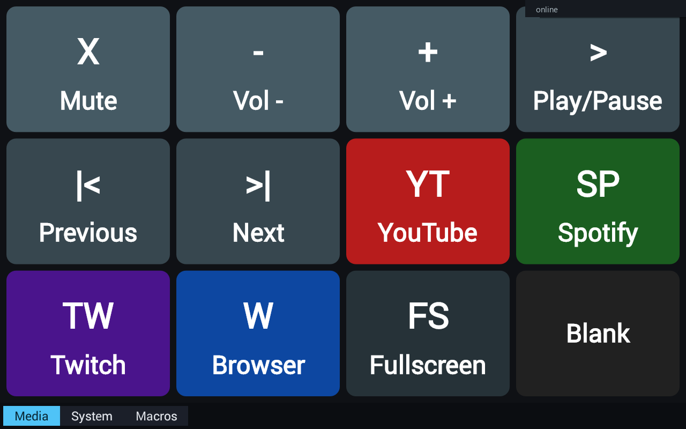
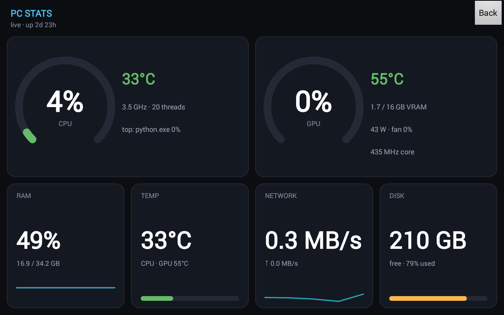
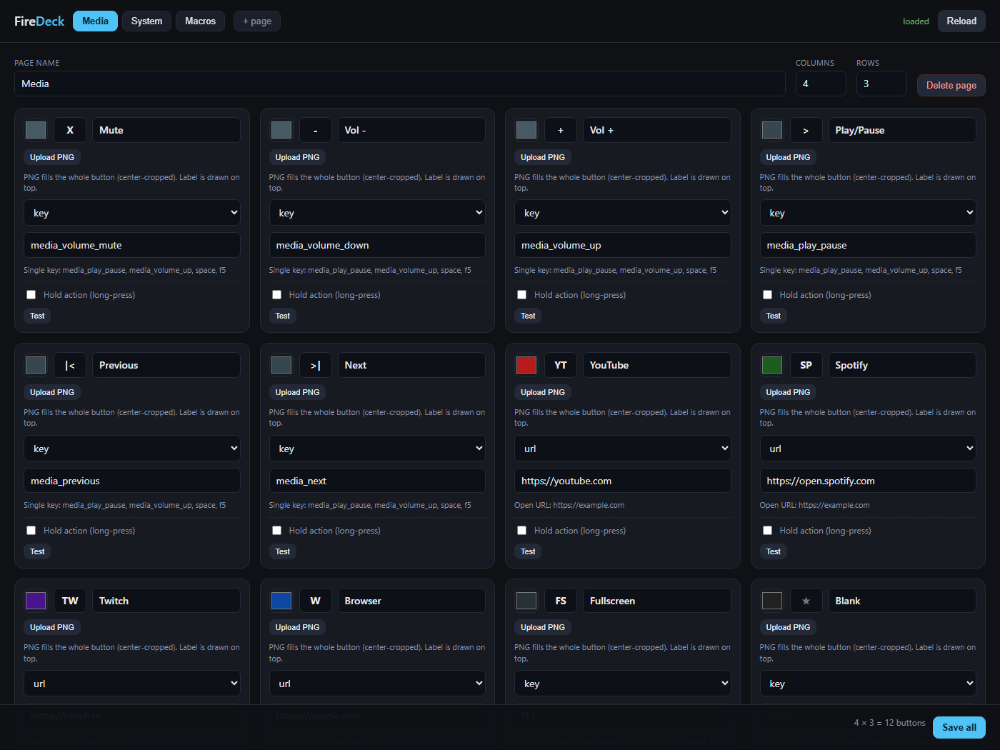

# FireDeck

A Stream Deck style button grid for the **2013 Kindle Fire HD 7"**
(`soho` / `KFSOWI`, Fire OS 4.5.5.3, Android 4.4.3, API 19), configured
from the PC in a browser.

## Screenshots

| Tablet deck | Live PC stats |
|---|---|
|  |  |



## Features

- **Multiple pages** with tabs at the bottom of the tablet screen
- **PNG icons** uploaded per button from the config page
- **Long-press (hold) actions** — a second action per button
- **Macros** — multi-step sequences with delays
- **Live PC stats overlay** — CPU, GPU, RAM, temps, network, disk
- Action types: `key`, `hotkey`, `text`, `launch`, `url`, `command`, `macro`, `stats`
- Config page: <http://localhost:9100>

```
PC                                        Tablet
┌─────────────────────────┐   HTTP        ┌──────────────────────┐
│ deck_server.py (9100)   │◄──────────────│ FireDeck.apk         │
│  /            config UI │  /layout poll │  pages + tabs        │
│  /layout      JSON      │  /press       │  PNG icons           │
│  /press       actions   │  /icon upload │  press + hold        │
│  /icons/...   images    │──────────────►│                      │
└─────────────────────────┘               └──────────────────────┘
```

## Quick start

1. **Start the server**: `server\start_server.bat`
   (or `python server\deck_server.py --port 9100`)
2. **Open the config page**: <http://localhost:9100>
3. **Launch FireDeck** on the tablet (defaults to `192.168.1.100:9100`;
   tap the "online" label to set your PC's IP and port).

Saving in the browser updates the tablet within ~3 seconds.

> After restarting the server, click **Reload** in the browser before editing —
> otherwise you may save a stale layout over the current one.

## Config page

- **Pages**: tabs at the top, `+ page` to add, `Delete page` to remove.
- **Grid size**: columns/rows per page (1–8).
- **Button card**:
  - colour, icon text, label
  - **Upload PNG icon** (stored in `server/icons/`)
  - action type + value
  - **Hold action** checkbox → long-press action
  - **Test** / **Test hold**
- **Save all** writes to `server/layout.json`.

## Action types

| Type | Value examples | Effect |
|---|---|---|
| `key` | `media_play_pause`, `media_volume_up`, `space`, `f5` | one key |
| `hotkey` | `ctrl+shift+s`, `win+l`, `alt+tab` | key combo |
| `text` | `hello world` | types text |
| `launch` | `notepad`, `C:\path\app.exe` | starts a program |
| `url` | `https://example.com` | opens browser |
| `command` | `start cmd` | shell command |
| `macro` | multi-line (below) | runs steps in order |
| `stats` | *(none)* | opens the live PC stats overlay on the tablet |

### Macro syntax

One step per line, `type value`:

```
hotkey ctrl+s
delay 500
text hello world
launch notepad
url https://example.com
command start cmd
key media_volume_up
```

`delay` is milliseconds. Lines starting with `#` are ignored.

## PC stats overlay

A button with `"type": "stats"` opens a live dashboard on the tablet
(tap **Back** to return). It refreshes every 1.5 s:

- **CPU / GPU gauge cards** with temperature, clocks, VRAM, power, fan and
  the current top process
- **RAM / TEMP / NETWORK / DISK** tiles with bars and rolling sparklines
- colours change green → amber → red at 60 % / 85 %

| Tile | Source |
|---|---|
| CPU % | `psutil` |
| CPU temp | LibreHardwareMonitor web server (`CPU Package`) |
| GPU % / temp / VRAM / power / fan / clock | `nvidia-smi` |
| RAM | `psutil` |
| NETWORK | `psutil` counters (MB/s) |
| DISK / uptime | `psutil` |
| Top process | `psutil` (idle/system filtered) |

### CPU temperature

Windows does not expose CPU package temperature to normal apps.
LibreHardwareMonitor is bundled at `tools\LibreHardwareMonitor\` and its web
server is pre-configured (`LibreHardwareMonitor.config`, port 8085). It needs
to run **as administrator** to read CPU sensors; start it before gaming and
enable *Options → Auto Start* if you want it at login.

Without LHM the TEMP tile falls back to GPU temperature and the CPU card shows
`n/a`.

### FPS

Not included yet: FPS requires RTSS (RivaTuner Statistics Server) shared
memory. Afterburner is installed but RTSS is not. Once RTSS is running, an FPS
tile can read the live frame rate.

Raw data: <http://localhost:9100/stats>

## Layout file

`server/layout.json`:

```json
{
  "version": 2,
  "pages": [
    {
      "name": "Media",
      "cols": 4,
      "rows": 3,
      "buttons": [
        {
          "label": "Mute", "icon": "X", "color": "#455A64",
          "image": "/icons/p0_b0_123.png",
          "type": "key", "value": "media_volume_mute",
          "hold": { "type": "hotkey", "value": "win+l" }
        }
      ]
    }
  ]
}
```

`server/layout.starter.v2.json` is a 3-page starter layout (Media / System /
Macros) you can copy over `layout.json` to start fresh.

## Autostart

Create a shortcut to `start_server.bat` in `shell:startup`.

## Security

No authentication; binds `0.0.0.0`. It can run arbitrary shell commands by
design (`command` and `macro`). LAN use only.

## Build the APK

```powershell
.\build.ps1
adb install -r .\FireDeck.apk
```

SDK build-tools + the JDK bundled with Android Studio; **v1 signing is
mandatory** for API 19.

## Notes

- The tablet UI is landscape; the Fire HD 7 panel reports its raw portrait
  framebuffer to `screencap`, so screenshots may need a 90°/180° rotation.
- Icons are cached by URL; re-uploading creates a new URL and refreshes.

## License

MIT - see [LICENSE](LICENSE).
